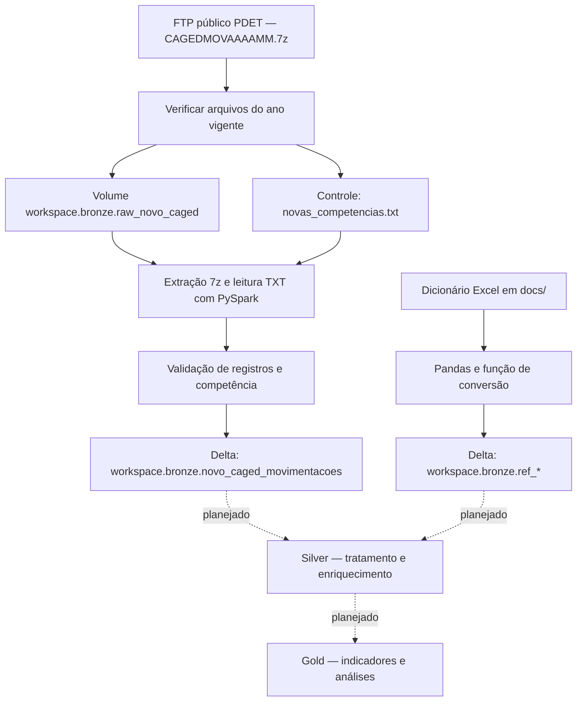

# Novo Caged — Engenharia de Dados | Free Edition

Projeto acadêmico de engenharia de dados para ingestão e organização dos microdados de movimentações do Novo Caged no Databricks Free Edition, com Python, PySpark, Delta Lake e Unity Catalog.

## Estado atual

O repositório contém configuração dos schemas, descoberta e download de arquivos do ano vigente, ingestão na camada Bronze e carga de dicionários de referência. A arquitetura Medallion é o objetivo do projeto; as transformações das movimentações para Silver e Gold e as análises ainda não estão implementadas.

| Componente | Implementação atual |
| --- | --- |
| Setup | Cria os schemas `workspace.bronze`, `workspace.silver` e `workspace.gold` |
| Descoberta | Consulta o FTP, compara competências com a Bronze e baixa arquivos novos |
| Bronze | Extrai arquivos 7z, valida competência e grava tabela Delta por competência |
| Referências | Converte dez abas do dicionário Excel em tabelas Delta na Bronze |
| Silver e Gold | Schemas criados; sem pipeline de movimentações implementado |
| Analytics, testes e infraestrutura | Notebooks vazios; sem análises, testes automatizados ou Terraform implementados |

## Arquitetura



Os arquivos brutos e a extração temporária ficam em um volume do Unity Catalog. O código atual não depende de provisionamento de ADLS Gen2 nem contém configuração funcional de Terraform. As tabelas são gravadas pelo nome no catálogo, sem localização externa explícita.

## Estrutura do repositório

```text
docs/
  dicionario-dados-novo-caged-movimentacao.xlsx
notebooks/
  00_setup/
    01_create_catolog_schema.ipynb
    02_commom_functions.py
  01_ingestao/
    00_verificar_novos_arquivos.ipynb
    01_landing_to_bronze.ipynb
  02_transformacao/
    01_dicionarios_referencia.ipynb
  03_analytics/                # notebook vazio
infrastructure/terraform/     # notebook vazio; sem arquivos Terraform
src/transformations/          # notebook vazio
tests/                        # test_bronze e test_silver vazios
```

Os nomes `catolog` e `commom` acima correspondem aos arquivos existentes.

## Pré-requisitos e configuração

- Workspace Databricks Free Edition com computação disponível, Spark, Delta Lake, Unity Catalog e acesso a volumes.
- Permissão para criar schemas, volume e tabelas no catálogo `workspace`.
- Acesso de rede ao FTP público usado pelo notebook; a conectividade deve ser verificada no ambiente.
- Bibliotecas `py7zr` para extração e `openpyxl` para leitura do Excel, além de Pandas e PySpark.

Importe ou conecte o repositório ao workspace. Os notebooks foram escritos para o Databricks e usam `spark`, `display`, `dbutils`, `%pip` e `%run`; não são scripts Python comuns para execução local.

1. Execute [01_create_catolog_schema.ipynb](notebooks/00_setup/01_create_catolog_schema.ipynb).
2. Crie o volume utilizado pelos notebooks; o setup atual cria somente os schemas:

   ```sql
   CREATE VOLUME IF NOT EXISTS workspace.bronze.raw_novo_caged;
   ```

3. Ajuste os caminhos de workspace do Excel e do `%run` em [02_commom_functions.py](notebooks/00_setup/02_commom_functions.py) e [01_dicionarios_referencia.ipynb](notebooks/02_transformacao/01_dicionarios_referencia.ipynb). Eles apontam para o diretório pessoal do autor.
4. Confira a instalação de `openpyxl`: a função comum contém `pip install openpyxl -q` sem o prefixo `%`. Se essa célula falhar no ambiente, instale a biblioteca em uma célula `%pip install openpyxl -q` antes da carga de referências. O notebook de ingestão já contém `%pip install py7zr -q`.

## Execução da ingestão

### Descoberta de novas competências

Execute [00_verificar_novos_arquivos.ipynb](notebooks/01_ingestao/00_verificar_novos_arquivos.ipynb). Ele consulta:

```text
ftp://ftp.mtps.gov.br/pdet/microdados/NOVO%20CAGED/
```

O notebook percorre somente o ano corrente, procura `CAGEDMOVAAAAMM.7z` e compara as competências com `workspace.bronze.novo_caged_movimentacoes`. Arquivos ainda não presentes no volume são baixados para:

```text
/Volumes/workspace/bronze/raw_novo_caged/<AAAA>/CAGEDMOV<AAAAMM>.7z
```

O tamanho baixado é comparado com o informado pelo FTP. O resultado é escrito em:

```text
/Volumes/workspace/bronze/raw_novo_caged/_controle/novas_competencias.txt
```

O controle contém competências separadas por vírgula ou `NENHUMA`. Se nenhum arquivo for encontrado no FTP para o ano corrente, o notebook interrompe por uma asserção antes de atualizar esse controle.

### Landing para Bronze

Execute [01_landing_to_bronze.ipynb](notebooks/01_ingestao/01_landing_to_bronze.ipynb). A seleção da carga usa esta prioridade:

| Entrada | Comportamento |
| --- | --- |
| Widget `competencias_processar = TODAS` | Processa todos os arquivos disponíveis no volume |
| Widget com `AAAAMM,AAAAMM` | Filtra o laço de carga para essas competências |
| Widget vazio e controle existente | Usa as competências do controle; `NENHUMA` encerra o notebook sem ingestão |
| Widget vazio e controle ausente | Processa todos os arquivos disponíveis no volume |

**Atenção às células de demonstração:** antes do laço de carga, o notebook procura e grava a competência fixa `202101`. O filtro do widget não se aplica a essas células. Para executar o notebook inteiro, disponibilize esse arquivo no volume ou ajuste/pule as células de demonstração antes de usar o fluxo operacional. Sem o arquivo, a seleção com `next(...)` falha. Para anos anteriores ao corrente, os arquivos precisam ser disponibilizados no volume separadamente, pois a descoberta automática consulta apenas o ano vigente.

A ingestão extrai o TXT, lê o delimitador `;` em UTF-8 e mantém as colunas de origem como texto. Acrescenta:

- `_competencia_referencia`
- `_arquivo_origem`
- `_caminho_origem`
- `_data_ingestao`

Antes da gravação, exige registros e verifica se `competênciamov` corresponde à competência derivada do nome do arquivo. A tabela é criada em Delta com clustering por `_competencia_referencia`; reprocessamentos sobrescrevem os registros da competência selecionada. O laço remove o TXT temporário após a gravação e mantém os arquivos 7z.

Para automatizar a sequência, configure no Databricks um job com a descoberta seguida da ingestão, após tratar as células de demonstração. O repositório não contém definição de job nem agendamento versionados.

## Dicionários de referência

Execute [01_dicionarios_referencia.ipynb](notebooks/02_transformacao/01_dicionarios_referencia.ipynb) após ajustar os caminhos e instalar as dependências. Ele usa o [dicionário Excel](docs/dicionario-dados-novo-caged-movimentacao.xlsx) e a função `convert_excel_to_delta_table`.

As chamadas atuais gravam em `workspace.bronze`:

```text
ref_regiao
ref_municipio
ref_uf
ref_secao
ref_subclasse
ref_categoria
ref_cbo_ocupacao
ref_grau_instrucao
ref_tipo_movimentacao
ref_tipo_estabelecimento
```

A função renomeia `Código` e `Descrição` para `codigo` e `descricao`, converte para texto e remove espaços nas extremidades. Não há validação explícita de duplicidades nem rotina de atualização das referências. A escrita usa `saveAsTable` sem modo de sobrescrita; executar novamente com tabelas existentes pode falhar.

## Verificação dos resultados

O notebook de ingestão mostra a contagem por competência e o histórico Delta. Também é possível consultar:

```sql
SELECT
  _competencia_referencia,
  COUNT(*) AS registros
FROM workspace.bronze.novo_caged_movimentacoes
GROUP BY _competencia_referencia
ORDER BY _competencia_referencia;

DESCRIBE HISTORY workspace.bronze.novo_caged_movimentacoes;
```

Essas verificações não substituem testes automatizados. Os arquivos em `tests/` ainda estão vazios.

## Limitações e próximos passos

- Validar a execução integral no workspace, incluindo conectividade FTP, bibliotecas e permissões.
- Separar as células didáticas da carga operacional e parametrizar caminhos e competências.
- Implementar as transformações Silver, enriquecimento com referências e indicadores Gold.
- Implementar testes de qualidade, atualização das referências e tratamento de falhas.
- Versionar a configuração dos jobs e definir a estratégia para revisões de competências já ingeridas; a descoberta atual ignora meses que já constam na Bronze.
- Avaliar os recursos disponíveis na conta Free Edition antes de ampliar a carga.

Este README descreve o código disponível no repositório; não representa uma certificação de execução do pipeline no Databricks.
