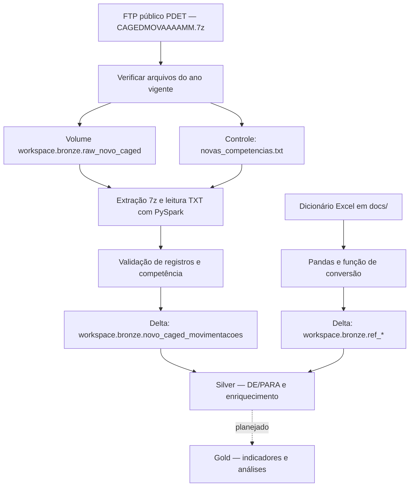

# Novo Caged — Engenharia de Dados | Free Edition

Projeto acadêmico de engenharia de dados para ingestão e organização dos microdados de movimentações do Novo Caged no Databricks Free Edition, com Python, PySpark, Delta Lake e Unity Catalog.

**Organização Trabalho via Trello:** https://trello.com/invite/b/6aca28ac2b79adb2bdb0327f/ATTI0613962c5f2f6d8644243304ce2c6644C3F64287/mba-previsao-da-demanda-por-ocupacoes

## Estado atual

O repositório contém configuração dos schemas, descoberta e download de arquivos do ano vigente, ingestão na camada Bronze e carga de dicionários de referência. A arquitetura Medallion é o [...]

| Componente | Implementação atual |
| --- | --- |
| Setup | Cria os schemas `workspace.bronze`, `workspace.silver` e `workspace.gold` |
| Descoberta | Consulta o FTP, compara competências com a Bronze e baixa arquivos novos |
| Bronze | Extrai arquivos 7z, valida competência e grava tabela Delta por competência |
| Referências | Converte dez abas do dicionário Excel em tabelas Delta na Bronze |
| Silver | Ingestão de cursos FATEC e cruzamento semântico com ocupações CBO (DE/PARA implementado) |
| Gold | Schemas criados; sem pipeline de movimentações implementado |
| Analytics, testes e infraestrutura | Notebooks vazios; sem análises, testes automatizados ou Terraform implementados |

## Escopo do estudo e limitação de abrangência

A presente iniciativa foi concebida para responder a uma questão de negócio mais ampla: **integrar dados históricos de emprego e educação profissional para apoiar a previsão de admissões por ocupação e região e subsidiar decisões de planejamento da oferta de cursos no Brasil**. Nesse contexto, o objetivo principal do projeto não é constituir um mapeamento universal de todas as profissões existentes no mercado de trabalho brasileiro, nem um catálogo completo das ocupações registradas na CBO, mas **desenvolver uma solução de Engenharia de Dados e Machine Learning capaz de analisar tendências de emprego formal e relacioná-las à oferta de formação profissional**.

Dentro deste contexto, o **estudo de correspondência entre cursos da FATEC e ocupações do CAGED (DE/PARA) representa uma etapa de apoio metodológico e não o objetivo central do projeto**. Ele foi conduzido como um recorte analítico para avaliar a aderência entre formação profissional e demanda de ocupações em um conjunto de dados delimitado. Assim, o mapeamento realizado considera, de forma intencional, apenas:

- Os cursos da FATEC disponíveis no ambiente de trabalho;
- As ocupações CBO selecionadas como referência dentro do recorte do CAGED 2025;
- O DE/PARA gerado por similaridade semântica entre curso, eixo tecnológico e descrição da ocupação.

A limitação desse escopo é uma **decisão metodológica e não uma falha do processo**. O projeto não busca cobrir o universo completo de ocupações da CBO, nem afirmar que todos os cursos e profissões existentes no mercado brasileiro foram contemplados. O trabalho foi desenhado como uma solução estratégica para um problema específico, com foco em dados públicos, previsões mensais de admissões e análise de alinhamento entre formação e mercado, e não como um inventário definitivo de todas as relações entre educação e ocupação.

### Por que essa restrição é importante

A relação entre cursos e ocupações não é direta nem unívoca. Muitas profissões não possuem correspondência clara com um curso específico, e muitas ocupações podem ser relacionadas a múltiplos perfis formativos. Por isso, o projeto adota uma **abordagem documental e controlada de correspondência**, registrando relações com maior ou menor grau de similaridade e marcando eventuais ambiguidades, em vez de presumir equivalência direta entre curso e ocupação.

Essa limitação de escopo também segue as práticas de **Lean Six Sigma**, especialmente no contexto do ciclo DMAIC (Define, Measure, Analyze, Improve, Control). Na fase Define, o problema, os objetivos e os limites da análise são explicitados para reduzir ambiguidade, evitar supergeneralização e preservar a validade do estudo. Em termos práticos:

- **Define**: o problema de negócio e o escopo da solução são delimitados;
- **Measure**: os dados são avaliados no contexto real da base disponível;
- **Analyze**: a análise se concentra no conjunto de relações que podem ser sustentadas pela metodologia adotada;
- **Improve**: ações e decisões são orientadas por indicadores e por uma visão controlada do problema;
- **Control**: o estudo impede conclusões extrapoladas além do contexto e reduz ruído analítico.

A restrição do estudo aos cursos da FATEC e ao subconjunto de ocupações do DE/PARA é uma **escolha consciente de governança do projeto**. Ela não desqualifica o objetivo maior do trabalho, mas organiza a execução em um escopo viável e metodologicamente defensável. O estudo continua sendo relevante ao problema original, pois oferece um mecanismo de apoio para análise de alinhamento entre formação e mercado, mantendo transparência sobre os limites do recorte adotado.

## Arquitetura



Os arquivos brutos e a extração temporária ficam em um volume do Unity Catalog. O código atual não depende de provisionamento de ADLS Gen2 nem contém configuração funcional de Terraform. A[...]

## Estrutura do repositório

```text
docs/
  dicionario-dados-novo-caged-movimentacao.xlsx
  de-para-fatec-caged-2025-specs.md              ← Nova documentação DE/PARA
notebooks/
  00_setup/
    01_create_catolog_schema.ipynb
    02_commom_functions.py
  01_ingestao/
    00_verificar_novos_arquivos.ipynb
    01_landing_to_bronze.ipynb
  02_transformacao/
    01_dicionarios_referencia.ipynb
    02_de_para_fatec_ocupacoes_cbo.ipynb         ← Novo notebook DE/PARA
  03_analytics/                                  # notebook vazio
infrastructure/terraform/                       # notebook vazio; sem arquivos Terraform
src/transformations/                             # notebook vazio
tests/                                           # test_bronze e test_silver vazios
```

Os nomes `catolog` e `commom` acima correspondem aos arquivos existentes.

## Pré-requisitos e configuração

- Workspace Databricks Free Edition com computação disponível, Spark, Delta Lake, Unity Catalog e acesso a volumes.
- Permissão para criar schemas, volume e tabelas no catálogo `workspace`.
- Acesso de rede ao FTP público usado pelo notebook; a conectividade deve ser verificada no ambiente.
- Bibliotecas `py7zr` para extração e `openpyxl` para leitura do Excel, além de Pandas e PySpark.

Importe ou conecte o repositório ao workspace. Os notebooks foram escritos para o Databricks e usam `spark`, `display`, `dbutils`, `%pip` e `%run`; não são scripts Python comuns para execução[...]

1. Execute [01_create_catolog_schema.ipynb](notebooks/00_setup/01_create_catolog_schema.ipynb).
2. Crie o volume utilizado pelos notebooks; o setup atual cria somente os schemas:

   ```sql
   CREATE VOLUME IF NOT EXISTS workspace.bronze.raw_novo_caged;
   ```

3. Ajuste os caminhos de workspace do Excel e do `%run` em [02_commom_functions.py](notebooks/00_setup/02_commom_functions.py) e [01_dicionarios_referencia.ipynb](notebooks/02_transformacao/01_dic[...]
4. Confira a instalação de `openpyxl`: a função comum contém `pip install openpyxl -q` sem o prefixo `%`. Se essa célula falhar no ambiente, instale a biblioteca em uma célula `%pip install[...]

## Execução da ingestão

### Descoberta de novas competências

Execute [00_verificar_novos_arquivos.ipynb](notebooks/01_ingestao/00_verificar_novos_arquivos.ipynb). Ele consulta:

```text
ftp://ftp.mtps.gov.br/pdet/microdados/NOVO%20CAGED/
```

O notebook percorre somente o ano corrente, procura `CAGEDMOV<AAAAMM>.7z` e compara as competências com `workspace.bronze.novo_caged_movimentacoes`. Arquivos ainda não presentes no volume são bai[...]

```text
/Volumes/workspace/bronze/raw_novo_caged/<AAAA>/CAGEDMOV<AAAAMM>.7z
```

O tamanho baixado é comparado com o informado pelo FTP. O resultado é escrito em:

```text
/Volumes/workspace/bronze/raw_novo_caged/_controle/novas_competencias.txt
```

O controle contém competências separadas por vírgula ou `NENHUMA`. Se nenhum arquivo for encontrado no FTP para o ano corrente, o notebook interrompe por uma asserção antes de atualizar esse[...]

### Landing para Bronze

Execute [01_landing_to_bronze.ipynb](notebooks/01_ingestao/01_landing_to_bronze.ipynb). A seleção da carga usa esta prioridade:

| Entrada | Comportamento |
| --- | --- |
| Widget `competencias_processar = TODAS` | Processa todos os arquivos disponíveis no volume |
| Widget com `AAAAMM,AAAAMM` | Filtra o laço de carga para essas competências |
| Widget vazio e controle existente | Usa as competências do controle; `NENHUMA` encerra o notebook sem ingestão |
| Widget vazio e controle ausente | Processa todos os arquivos disponíveis no volume |

**Atenção às células de demonstração:** antes do laço de carga, o notebook procura e grava a competência fixa `202101`. O filtro do widget não se aplica a essas células. Para executar o[...]

A ingestão extrai o TXT, lê o delimitador `;` em UTF-8 e mantém as colunas de origem como texto. Acrescenta:

- `_competencia_referencia`
- `_arquivo_origem`
- `_caminho_origem`
- `_data_ingestao`

Antes da gravação, exige registros e verifica se `competênciamov` corresponde à competência derivada do nome do arquivo. A tabela é criada em Delta com clustering por `_competencia_referenc[...]

Para automatizar a sequência, configure no Databricks um job com a descoberta seguida da ingestão, após tratar as células de demonstração. O repositório não contém definição de job nem[...]

## Dicionários de referência

Execute [01_dicionarios_referencia.ipynb](notebooks/02_transformacao/01_dicionarios_referencia.ipynb) após ajustar os caminhos e instalar as dependências. Ele usa o [dicionário Excel](docs/dic[...]

As chamadas atuais gravam em `workspace.bronze`:

```text
ref_regiao
ref_municipio
ref_uf
ref_secao
ref_subclasse
ref_categoria
ref_cbo_ocupacao
ref_grau_instrucao
ref_tipo_movimentacao
ref_tipo_estabelecimento
```

A função renomeia `Código` e `Descrição` para `codigo` e `descricao`, converte para texto e remove espaços nas extremidades. Não há validação explícita de duplicidades nem rotina de at[...]

## DE/PARA: Cursos FATEC × Ocupações CBO 2025

Execute [02_de_para_fatec_ocupacoes_cbo.ipynb](notebooks/02_transformacao/02_de_para_fatec_ocupacoes_cbo.ipynb) para mapear os cursos da FATEC para as ocupações CBO mais relevantes usando similaridade semântica.

**Tabela resultante:** `workspace.silver.cursos_fatec_ocupacoes_cbo_2025`  
**Linhas:** 116 (um curso por linha)  
**Colunas:** 8 (curso, eixo_tecnologico, ocupacao_cbo, cbo_codigo, movimentacoes_2025, similaridade, forca_match)

**Distribuição de qualidade:**
- **Matches fortes (≥ 0.7):** 64 cursos (55%)
- **Matches fracos (< 0.7):** 52 cursos (45%)

Para entender a metodologia, limitações e interpretação dos resultados, consulte a [especificação completa do DE/PARA](docs/de-para-fatec-caged-2025-specs.md).

## Verificação dos resultados

O notebook de ingestão mostra a contagem por competência e o histórico Delta. Também é possível consultar:

```sql
SELECT
  _competencia_referencia,
  COUNT(*) AS registros
FROM workspace.bronze.novo_caged_movimentacoes
GROUP BY _competencia_referencia
ORDER BY _competencia_referencia;

DESCRIBE HISTORY workspace.bronze.novo_caged_movimentacoes;
```

Para explorar o DE/PARA:

```sql
SELECT * FROM workspace.silver.cursos_fatec_ocupacoes_cbo_2025
ORDER BY similaridade DESC;
```

Essas verificações não substituem testes automatizados. Os arquivos em `tests/` ainda estão vazios.

## Limitações e próximos passos

- Implementar as transformações Silver completas, enriquecimento com referências e indicadores Gold.
- Implementar testes de qualidade, atualização das referências e tratamento de falhas.
- Versionar a configuração dos jobs e definir a estratégia para revisões de competências já ingeridas; a descoberta atual ignora meses que já constam na Bronze.
- Avaliar os recursos disponíveis na conta Free Edition antes de ampliar a carga.
- Revisar e validar os matches fracos do DE/PARA com especialistas de domínio.

Este README descreve o código disponível no repositório; não representa uma certificação de execução do pipeline no Databricks.
